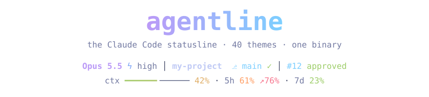
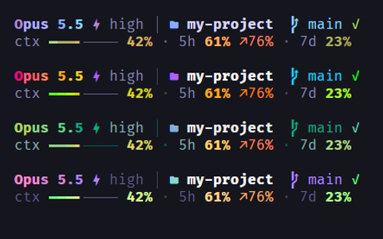

<div align="center">



Model, Git, PR, context and quotas on two lines, in 49 themes: one by default, one per project, one per branch.

[](https://github.com/adrien-ln/agentline/actions/workflows/ci.yml)
[](https://github.com/adrien-ln/agentline/releases/latest)
[](LICENSE)


</div>

## Requirements

| | |
|---|---|
| **Claude Code** | the statusline is declared in `~/.claude/settings.json`. Antigravity CLI and Copilot CLI work too (see below) |
| **A Nerd Font, set in your terminal** | for the icons. `agentline install` offers to install one (Fira Code, JetBrains Mono, Cascadia Code, Hack or Meslo) and sets it in Windows Terminal and VS Code; `agentline font set <name>` changes it later, `agentline font test` shows whether yours has every glyph; other terminals: choose it in their settings. No Nerd Font: `agentline style set icons text` |
| **A modern terminal** | Windows: **Windows Terminal** or the VS Code terminal (not the old console window). macOS, Linux: any terminal; 24-bit color is best |
| **Git** on the PATH | for the branch and its status |

## Install

**Windows**, with [Scoop](https://scoop.sh):

```powershell
scoop bucket add agentline https://github.com/adrien-ln/scoop-agentline
scoop install agentline
```

**macOS and Linux**, with [Homebrew](https://brew.sh):

```bash
brew install adrien-ln/agentline/agentline
agentline install --in-place
```

or with the install script (checks the SHA-256 checksum, installs to `~/.local/bin`; [read it first](scripts/installer-agentline.sh)):

```bash
curl -fsSL https://raw.githubusercontent.com/adrien-ln/agentline/main/scripts/installer-agentline.sh | bash
```

**With Go 1.26+**, on any system:

```bash
go install github.com/adrien-ln/agentline/cmd/agentline@latest
agentline install
```

`agentline install` puts the binary on the PATH (not with `--in-place`, used when Scoop or Homebrew own it), declares the statusline in `~/.claude/settings.json` and offers a Nerd Font. Every file it changes gets a dated `.bak` copy.

## Check

```bash
agentline doctor
```

It checks the binary, `settings.json`, the font, the colors and the background, and gives the command that fixes each problem. Then open a new Claude Code session.

## Use

```bash
agentline          # pick a theme (Enter) and where it applies (p this project, b this branch, d everywhere), then s to save
agentline style    # show, hide, move and tune each item of the statusline
agentline help     # every command
```

<div align="center">

</div>

## Why agentline

Claude Code runs the statusline command again and again during a session, so it has to start fast and stay out of the way.

- **One native binary**: no Node.js, Bun or `npx`. A render takes about 50 ms on Windows (from Git Bash, which costs about 20 ms to start any process), Git state cached for 5 s.
- **No network calls** from the statusline: everything comes from what the tool sends and from `git`; nothing leaves your machine.
- **A theme per project and per branch**, and **one look for several agents**: Claude Code, Antigravity CLI and Copilot CLI.

Compared with [ccstatusline](https://github.com/sirmalloc/ccstatusline), the most popular Claude Code statusline:

| | agentline | ccstatusline |
|---|---|---|
| Runs with | a single binary | Node.js or Bun (`npx`, `bunx` or a global install) |
| Time per render | about 50 ms (measured above) | 1.1 s with `npx`, 0.2 to 0.6 s with `bunx` (from its README) |
| Network | none | its usage and Claude status widgets call online services |
| Tools | Claude Code, Antigravity CLI, Copilot CLI | Claude Code |
| Customization | 49 themes, per project or branch; items shown, hidden and moved with `agentline style` | many more widgets (Jujutsu, CI status, cache timer, extra usage…), Powerline, gradients, any number of lines |

If you want every widget and Powerline, ccstatusline does more. If you want a fast, offline statusline that follows your projects and branches, that is what agentline is for.

## Good to know

- **Settings** live in `~/.config/agentline` (or `$AGENTLINE_CONFIG`). Your own themes go in its `themes/` folder: see [docs/themes.md](docs/themes.md).
- **Language**: English or French, from your system; force it with `AGENTLINE_LANG=en` or `fr`.
- **Light background**: detected by `agentline install`; otherwise `agentline theme background light`.
- **Over SSH**: the full statusline, with the font of the terminal on your own machine. For one short line without icons: `agentline style set ssh.short yes`.
- **Other tools**: `agentline install` also offers to set the statusline of **Antigravity CLI** and **Copilot CLI** when they are installed (Copilot: turn the statusline on with `/experimental`). By hand: `agentline render --from antigravity` or `--from copilot` as their `statusLine` command. Copilot sends no quotas or cost.

## Uninstall

```bash
scoop uninstall agentline                                    # Scoop
agentline uninstall --in-place && brew uninstall agentline   # Homebrew
agentline uninstall                                          # install script or Go
```

Your settings in `~/.config/agentline` stay. [MIT license](LICENSE).
